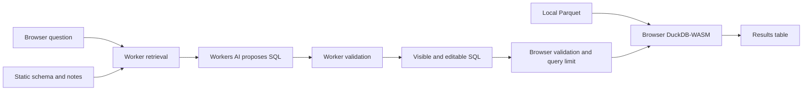

# Interview walkthrough

This is a preparation guide, not a claim that the candidate has already reviewed every line. Read the listed modules and explain each boundary in your own words before submitting.

## Five-minute architecture explanation

“Questions go to a Cloudflare Worker. It retrieves a few curated notes and sends only the question, schema and documentation to Workers AI. The model proposes SQL; it never runs a query or sees dataset rows. The browser shows that SQL, validates a restricted SELECT subset, reconstructs the executable statement, and runs it in DuckDB-WASM against locally loaded taxi data. Edits use the same browser guard. Results expose the exact query executed.”

The dataset and results have no arrow to the model. The user can still paste rows into a question; the app cannot reliably recognize arbitrary pasted data. Do not overstate this boundary.

## Code to read, in order

| Module | Explain this responsibility |
| --- | --- |
| src/App.tsx | Question/SQL/result state, provenance, stale-result clearing, generation vs local-query cancellation |
| src/api.ts | Only question/contextMode are sent; API errors and rejected proposals remain inspectable |
| worker/index.ts | Bounded request contract, fixture/live separation, structured output checks, server-side SQL guard |
| worker/retrieval.ts and snippets.ts | Small curated corpus, rare-term weighting, deterministic top four, fixed no-context control |
| shared/schema.ts | Metadata shared by prompt and validator, without observed row values |
| src/sql-validator.ts | Fail-closed parser subset, identifiers/functions/types, literal escaping, reconstruction rather than raw execution |
| src/query-runner.ts | Validation before driver call, 501-row detection/500-row display, timeout, worker destruction, session invalidation |
| src/database.ts and use-database.ts | Worker/WASM loading, materialization, external-access lock, reload/cleanup lifecycle |
| src/evaluate-live.ts and compare-results.ts | Independent expectations, fair paired conditions, shape/value comparisons, archived failures |

## Decisions to defend

**Why a restricted compiler?** SELECT can call file/network functions. Prefix checks cannot establish safety. A parser also speaks a different dialect from DuckDB, so the guard emits only approved syntax instead of forwarding the original text. This limits SQL coverage. CTEs, joins and arbitrary functions are deliberately rejected. Runtime external-access restrictions add a second layer; a browser developer-tools user can bypass client code, which is outside the model/editor guard's threat boundary.

**Why materialize the data?** It lets trusted initialization read Parquet and then turn external access off. The tradeoff is startup/memory and losing later Parquet column-pruning benefits. The file is ~50 MB compressed; that is not its in-memory footprint. A 500-row output limit does not limit GROUP BY memory.

**Why lexical retrieval?** Eighteen notes are small enough for a transparent, provisioning-free retriever. The initial tie-based ranking missed a critical note. Rare-term weights fixed the recorded case, but “fraction/gratuities” still misses it. A larger held-out paraphrase set is the next test before adopting embeddings/reranking.

**Why the verification matters?** Without context, metered fare became about $73.96m instead of $53.88m. Both are plausible-looking aggregates. An initial tip query returned 28.695695% instead of 22.467684%. Executing successfully is insufficient.

For intuition: a $10 fare with a $2 tip has a 20% tip; a $100 fare with a $10 tip has 10%. Their average percentage is 15%, but their combined tip share is 12/110 = 10.91%. The question/metric definition decides which is correct.

**Why preserve failed runs?** The first evaluator also made a false assumption about required columns. The original JSON, explicit audit and revised run let a reviewer distinguish scorer fixes, retrieval changes and genuine model errors. Scores across changed prompt versions are not a clean ranking-only causal experiment.

## Changed requirements

**Second dataset and joins:** identify stable keys and relationship cardinality first. Extend schema/relationship notes and identifier resolution; one trips-table allowlist is no longer sufficient. Add join support deliberately to the compiler, with checks for ambiguous columns, unknown relations and disallowed nested operations. Test duplicate-key inflation, unmatched rows, NULLs, many-to-many joins and cross-table aggregates. Recheck browser memory and load time. “Just allow JOIN” is not enough.

**Dataset too large for the browser:** first measure compressed bytes, projected columns, query patterns and memory. Remote Parquet range reads could help some workloads, but conflict with the current external-access lockdown and do not solve every aggregation. A trusted backend query service/warehouse may be necessary. Keep the LLM metadata-only, enforce read-only SQL/data access and compute budgets server-side, and explicitly revisit the original local-data privacy boundary. Do not assume full DuckDB can simply move into a Cloudflare Worker without testing runtime limits.

## Pairing rehearsal

1. Run one question, inspect its note IDs and executable SQL, then edit it to a card-only count. Explain why editing invokes no model call.
2. Try DROP, stacked statements and a SELECT file reader; identify which guard rejects each.
3. Explain one golden answer's independent calculation and one missing-data refusal.
4. Trace a small change, such as a supported metric or result limit, through policy, prompt/UI, tests and documentation. Search for related constants and UI copy; do not assume one edit covers all behavior.
5. State the limits honestly: small evaluation set, lexical vocabulary gaps, incomplete grammar, unbounded intermediate memory, startup CDN dependency and unproven public-hosting controls.

If a generated change is unclear, inspect it and ask the agent for a smaller patch. Re-run the checks relevant to that change. The guide is complete; personal rehearsal and understanding cannot be automated.
